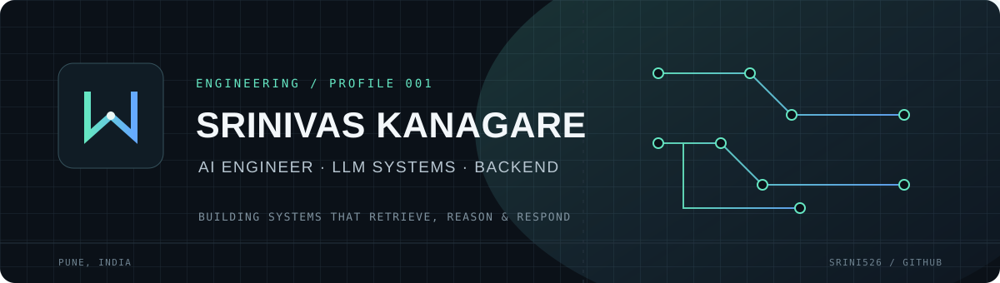
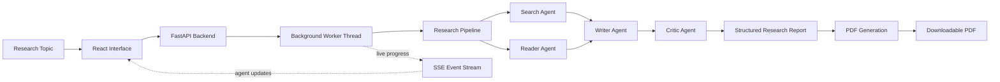
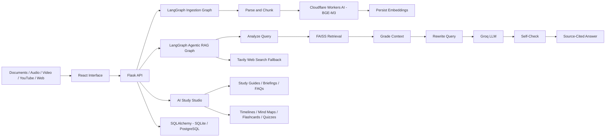

 

[Portfolio](https://www.srinivaskanagare.online) ·
[LinkedIn](https://www.linkedin.com/in/srinivas-kangare/) ·
[Email](mailto:kangaresrinivas@gmail.com)

**PUNE, INDIA** &nbsp; / &nbsp; **OPEN TO AI & SOFTWARE ENGINEERING OPPORTUNITIES**

---

## 01 — The work

I’m a Computer Science & Engineering graduate focused on building practical AI applications and dependable software systems.

My work sits at the intersection of **Generative AI, agentic workflows, retrieval systems, and backend engineering**. I enjoy taking a problem from architecture to implementation — connecting models, data, APIs, and interfaces into something people can use.

| Focus | What I work on |
|---|---|
| **Agentic systems** | Multi-agent orchestration, tool use, stateful workflows, and critique loops |
| **LLM applications** | RAG pipelines, embeddings, semantic retrieval, and grounded generation |
| **Backend engineering** | Python services, API design, streaming responses, and data workflows |
| **Delivery** | Testing, containerization, CI/CD, and deployment |

---

## 02 — Selected systems

### 01 / Research Desk
**Multi-Agent AI Research System**

An interactive AI research workspace where four specialized agents — Search, Reader, Writer, and Critic — collaborate to investigate topics, extract information, synthesize findings, and produce structured research reports. Features a live animated interface that visualizes agent activities and handoffs throughout the research process.

**System flow**

**Engineering notes**
- Integrated the existing multi-agent research pipeline into a FastAPI backend without modifying its core agent, pipeline, and tool modules.
- Built an interactive React interface featuring four animated SVG agents with real-time working states, speech bubbles, and handoff animations.
- Implemented background research execution using worker threads to handle concurrent research jobs.
- Captured pipeline execution logs and streamed live agent progress to the frontend using Server-Sent Events (SSE).
- Implemented automatic SSE reconnection and event-stream resumption for ongoing research jobs.
- Developed structured research report presentation with animated text rendering and interactive source cards.
- Integrated PDF generation for downloadable research reports.

`Python` `FastAPI` `React` `Vite` `LangChain` `LangGraph` `Groq` `Cloudflare Workers AI` `Tavily` `Server-Sent Events` `Docker` `FPDF2` 

[Repository](https://github.com/srini526/Multi_Agent_AI_Research_System) · [Live application](https://multi-agent-ai-research-system-jet.vercel.app/)

---

### 02 / RAG-Based AI Notebook
**A NotebookLM-style AI workspace for knowledge discovery and learning**

An AI-powered study workspace where users organize documents, lecture materials, videos, YouTube links, and web pages into persistent notebooks. Each notebook becomes an interactive knowledge base for source-grounded conversations, research, and AI-generated study materials.

**System flow**

**Engineering notes**
- Designed separate LangGraph workflows for document ingestion and agentic RAG.
- Integrated Cloudflare Workers AI with BGE-M3 for embedding generation.
- Implemented FAISS-based vector retrieval with in-memory notebook indexes rebuilt from persisted embeddings.
- Built source-grounded conversations with clickable citations linking to exact supporting passages.
- Developed AI Study Studio for generating briefings, study guides, FAQs, timelines, mind maps, flashcards, and quizzes.
- Implemented persistent notebooks using SQLAlchemy with SQLite locally and PostgreSQL in production.
- Added device-key-based notebook ownership without conventional user authentication.
- Containerized the application with Docker and automated backend deployment to Hugging Face Spaces using GitHub Actions.
`Python` `Flask` `React Vite` `LangChain` `LangGraph` `Cloudflare Workers AI` `BGE-M3` `FAISS` `Groq` `Tavily` `SQLAlchemy` `PostgreSQL` `SQLite` `Docker` `GitHub Actions` `SSE`

[Repository](https://github.com/srini526/RAG_Based_AI_Notebook) · [Live application](https://ragbasedainotebook.vercel.app/)

---

### 03 / Brain Tumor Detection
**Deep learning for MRI image classification**

A medical-imaging research project using transfer learning to classify brain MRI scans.

- Implemented an image-classification pipeline using InceptionV3.
- Applied preprocessing, augmentation, and model fine-tuning.
- Used early stopping and model checkpointing during training.
- Achieved **88.75% classification accuracy** in the reported experiment.
- Presented the research at **ICETSE 2025**.

`Python` `TensorFlow` `Keras` `InceptionV3` `Deep Learning`

[Kaggle notebook](https://www.kaggle.com/code/srinivaskangare/bt-final)

---

## 03 — Engineering toolkit

| Discipline | Technologies |
|---|---|
| **AI / GenAI** | RAG, LangChain, LangGraph, Multi-Agent Systems, Prompt Engineering, Embeddings, Semantic Search, Tool Calling, Generative AI, Agentic AI |
| **Machine learning** | NLP, TensorFlow, Keras, Scikit-learn, Transfer Learning, NumPy, Pandas |
| **Backend** | Python, FastAPI, Flask, REST APIs, SSE, SQLAlchemy |
| **Frontend** | React, JavaScript, HTML, CSS, Tailwind CSS |
| **Data** | PostgreSQL, MySQL, MongoDB, SQLite |
| **Infrastructure** | Docker, Kubernetes, GitHub Actions, AWS, Linux, Git |

I choose tools based on the problem and system requirements — not the other way around.

---

## 04 — Experience & education

**Android App Development using GenAI Intern**  
MindMatrix.io · Feb 2026 – May 2026

Worked on GenAI-integrated Android application development and debugging using Java, Kotlin, Jetpack, and Gradle.

**B.E. — Computer Science & Design**  
Atria Institute of Technology · 2022 – 2026

CGPA: **7.41 / 10**  

---

## 05 — Other builds

- [LinkedIn Post Generator](https://github.com/srini526/LinkedIn_post_generator)
- [College Assistant](https://github.com/srini526/College_assistant)
- [Content Safety Analyzer](https://github.com/srini526/Content_saftety_analyzer)
- [Hinglish Script Writer](https://github.com/srini526/Hinglish_script_writer)

---

## 06 — Activity

---

**BUILD / TEST / LEARN / REPEAT**

If you're working on useful AI products or engineering systems,  
[let's connect](https://www.linkedin.com/in/srinivas-kanagare/).

