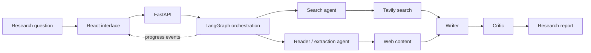
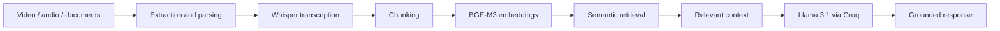

 

[Portfolio](https://www.srinivaskanagare.online) ·
[LinkedIn](https://www.linkedin.com/in/srinivas-kangare/) ·
[Email](mailto:kangaresrinivas@gmail.com)

**PUNE, INDIA** &nbsp; / &nbsp; **OPEN TO AI & SOFTWARE ENGINEERING OPPORTUNITIES**

---

## 01 — The work

I’m a Computer Science & Design graduate focused on building practical AI applications and dependable software systems.

My work sits at the intersection of **Generative AI, agentic workflows, retrieval systems, and backend engineering**. I enjoy taking a problem from architecture to implementation — connecting models, data, APIs, and interfaces into something people can use.

| Focus | What I work on |
|---|---|
| **Agentic systems** | Multi-agent orchestration, tool use, stateful workflows, and critique loops |
| **LLM applications** | RAG pipelines, embeddings, semantic retrieval, and grounded generation |
| **Backend engineering** | Python services, API design, streaming responses, and data workflows |
| **Delivery** | Testing, containerization, CI/CD, and deployment |

---

## 02 — Selected systems

### 01 / Research Desk
**Multi-Agent AI Research System**

A research workflow that coordinates specialized agents to search, inspect, synthesize, and critique information before producing a structured report.

**System flow**

**Engineering notes**
- Orchestrated a multi-agent research pipeline with LangChain and LangGraph.
- Connected web search and content extraction using Tavily and BeautifulSoup.
- Built a React interface backed by FastAPI.
- Streamed agent progress to the interface using Server-Sent Events (SSE).
- Added PDF generation for the final research output.

`Python` `LangGraph` `LangChain` `FastAPI` `React` `Tavily` `SSE`

[Repository](https://github.com/srini526/Multi_Agent_AI_Research_System) · [Live application](https://multi-agent-ai-research-system-jet.vercel.app/)

---

### 02 / RAG-Based AI Notebook
**A source-grounded workspace for learning and research**

An AI notebook that turns lecture media and documents into searchable knowledge, allowing users to ask questions grounded in their own material.

**System flow**

**Engineering notes**
- Built media-processing and transcription workflows using FFmpeg and Whisper.
- Processed source material into chunks for embedding and retrieval.
- Generated BGE-M3 embeddings through Ollama.
- Used semantic retrieval to provide relevant context to Llama 3.1 through Groq.
- Exposed the workflow through Flask APIs and a React interface.

`Python` `Flask` `React` `Whisper` `Ollama` `BGE-M3` `Groq` `RAG`

[Repository](https://github.com/srini526/RAG_Based_AI_Notebook) · [Live application](https://ragbasedainotebook.vercel.app/)

---

### 03 / Brain Tumor Detection
**Deep learning for MRI image classification**

A medical-imaging research project using transfer learning to classify brain MRI scans.

- Implemented an image-classification pipeline using InceptionV3.
- Applied preprocessing, augmentation, and model fine-tuning.
- Used early stopping and model checkpointing during training.
- Achieved **88.75% classification accuracy** in the reported experiment.
- Presented the research at **ICETSE 2025**.

`Python` `TensorFlow` `Keras` `InceptionV3` `Deep Learning`

[Kaggle notebook](https://www.kaggle.com/code/srinivaskangare/bt-final)

---

## 03 — Engineering toolkit

| Discipline | Technologies |
|---|---|
| **AI / GenAI** | LangChain, LangGraph, RAG, embeddings, semantic search, Whisper, Ollama, Groq, Gemini |
| **Machine learning** | TensorFlow, Keras, scikit-learn, NumPy, Pandas |
| **Backend** | Python, FastAPI, Flask, REST APIs, SSE, SQLAlchemy |
| **Frontend** | React, JavaScript, HTML, CSS, Tailwind CSS |
| **Data** | PostgreSQL, MySQL, MongoDB, SQLite |
| **Infrastructure** | Docker, Kubernetes, GitHub Actions, AWS, Linux, Git |

I choose tools based on the problem and system requirements — not the other way around.

---

## 04 — Experience & education

**Android App Development using GenAI Intern**  
MindMatrix.io · Feb 2026 – May 2026

Worked on GenAI-integrated Android application development and debugging using Java, Kotlin, Jetpack, and Gradle.

**B.E. — Computer Science & Design**  
Atria Institute of Technology · 2022 – 2026

CGPA: **7.53 / 10**  
Research presentation: **ICETSE 2025**

---

## 05 — Other builds

- [Content Safety Analyzer](https://github.com/srini526/Content_saftety_analyzer)
- [Hinglish Script Writer](https://github.com/srini526/Hinglish_script_writer)
- [Flagship Project](https://github.com/srini526/Flagship_project)

---

## 06 — Activity

---

**BUILD / TEST / LEARN / REPEAT**

If you're working on useful AI products or engineering systems,  
[let's connect](https://www.linkedin.com/in/srinivas-kangare/).

