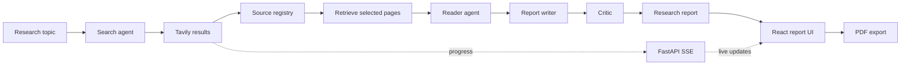
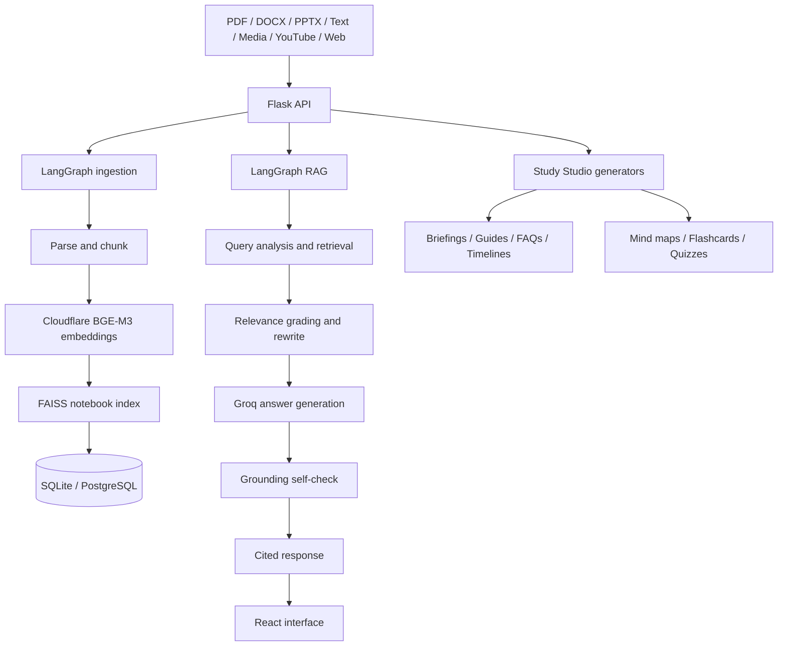

 

[Portfolio](https://www.srinivaskanagare.online) ·
[LinkedIn](https://www.linkedin.com/in/srinivas-kangare/) ·
[Email](mailto:kangaresrinivas@gmail.com)

**PUNE, INDIA** &nbsp; / &nbsp; **OPEN TO AI & SOFTWARE ENGINEERING OPPORTUNITIES**

---

## 01 — The work

I’m a Computer Science & Design graduate focused on building practical AI applications and dependable software systems.

My work sits at the intersection of **Generative AI, agentic workflows, retrieval systems, and backend engineering**. I enjoy taking a problem from architecture to implementation — connecting models, data, APIs, and interfaces into something people can use.

| Focus | What I work on |
|---|---|
| **Agentic systems** | Multi-agent orchestration, tool use, stateful workflows, and critique loops |
| **LLM applications** | RAG pipelines, embeddings, semantic retrieval, and grounded generation |
| **Backend engineering** | Python services, API design, streaming responses, and data workflows |
| **Delivery** | Testing, containerization, CI/CD, and deployment |

---

## 02 — Selected systems

### 01 / Research Desk
**Multi-Agent AI Research System**

An interactive research workspace that coordinates specialized search, reader, writer, and critic stages to investigate a topic and produce a structured, source-traceable report. The reader analyzes supplied evidence rather than browsing independently; source URLs are retained from actual search-tool results and displayed alongside the report.

**Workflow**

**Engineering highlights**
- Integrated a research pipeline with a FastAPI backend and background worker execution.
- Streamed live pipeline progress to the React interface using Server-Sent Events.
- Kept source IDs and URLs in Python-controlled records instead of relying on model-generated links.
- Built an animated interface for agent stages, report presentation, research history, and PDF export.
- Added bounded concurrent jobs and per-client active-run protection.

**Stack:** Python · FastAPI · React · Vite · LangChain · Groq · Cloudflare Workers AI · Tavily · SSE · FPDF2

[Repository](https://github.com/srini526/Multi_Agent_AI_Research_System) · [Live application](https://multi-agent-ai-research-system-jet.vercel.app/) · [Development plan](https://github.com/srini526/Multi_Agent_AI_Research_System/blob/main/plan.md)

---

### 02 / RAG-Based AI Notebook
**A source-grounded workspace for learning and knowledge discovery**

A notebook-style AI workspace where users bring documents, media, YouTube videos, and webpages together, then ask questions with citations and generate structured study materials.

**Workflow**

**Engineering highlights**
- Built separate LangGraph workflows for ingestion and agentic retrieval.
- Implemented BGE-M3 embeddings through Cloudflare Workers AI and FAISS-based similarity search.
- Added source-linked answers with page, slide, or timestamp context where available.
- Implemented query rewriting, relevance grading, optional Tavily web fallback, and an answer grounding check.
- Persisted notebooks, source passages, embeddings, chat messages, and generated outputs using SQLAlchemy.
- Added Docker-based deployment with a React frontend and Flask backend.

**Stack:** Python · Flask · React · Vite · LangChain · LangGraph · Cloudflare Workers AI · BGE-M3 · FAISS · Groq · Whisper · Tavily · SQLAlchemy · SQLite · PostgreSQL · Docker · GitHub Actions

[Repository](https://github.com/srini526/RAG_Based_AI_Notebook) · [Live application](https://ragbasedainotebook.vercel.app/) · [Development plan](https://github.com/srini526/RAG_Based_AI_Notebook/blob/main/plan.md)

---

### 03 / Brain Tumor Detection
**Deep learning for MRI image classification**

A medical-imaging research project using transfer learning to classify brain MRI scans.

- Implemented an image-classification pipeline using InceptionV3.
- Applied preprocessing, augmentation, and model fine-tuning.
- Used early stopping and model checkpointing during training.
- Achieved **88.75% classification accuracy** in the reported experiment.
- Presented the research at **ICETSE 2025**.

**Stack:** Python · TensorFlow · Keras · InceptionV3 · Deep Learning

[Kaggle notebook](https://www.kaggle.com/code/srinivaskangare/bt-final)

---

## 03 — Engineering toolkit

| Discipline | Technologies |
|---|---|
| **AI / GenAI** | RAG, LangChain, LangGraph, Multi-Agent Systems, Prompt Engineering, Embeddings, Semantic Search, Tool Calling, Generative AI, Agentic AI |
| **Machine learning** | NLP, TensorFlow, Keras, Scikit-learn, Transfer Learning, NumPy, Pandas |
| **Backend** | Python, FastAPI, Flask, REST APIs, SSE, SQLAlchemy |
| **Frontend** | React, JavaScript, HTML, CSS, Tailwind CSS |
| **Data** | PostgreSQL, MySQL, MongoDB, SQLite |
| **Infrastructure** | Docker, Kubernetes, GitHub Actions, AWS, Linux, Git |

I choose tools based on the problem and system requirements — not the other way around.

---

## 04 — Experience & education

**B.E. — Computer Science & Design**  
Atria Institute of Technology · 2022 – 2026

---

## 05 — Other builds

- [LinkedIn Post Generator](https://github.com/srini526/LinkedIn_post_generator)
- [College Assistant](https://github.com/srini526/College_assistant)
- [Content Safety Analyzer](https://github.com/srini526/Content_saftety_analyzer)
- [Hinglish Script Writer](https://github.com/srini526/Hinglish_script_writer)
- [Support Ticket Classifier](https://github.com/srini526/Support_ticket_classifier)
- [Mocktest](https://github.com/srini526/Mocktest)

---

## 06 — Activity

 

---

**BUILD / TEST / LEARN / REPEAT**

If you're working on useful AI products or engineering systems,  
[let's connect](https://www.linkedin.com/in/srinivas-kanagare/).

